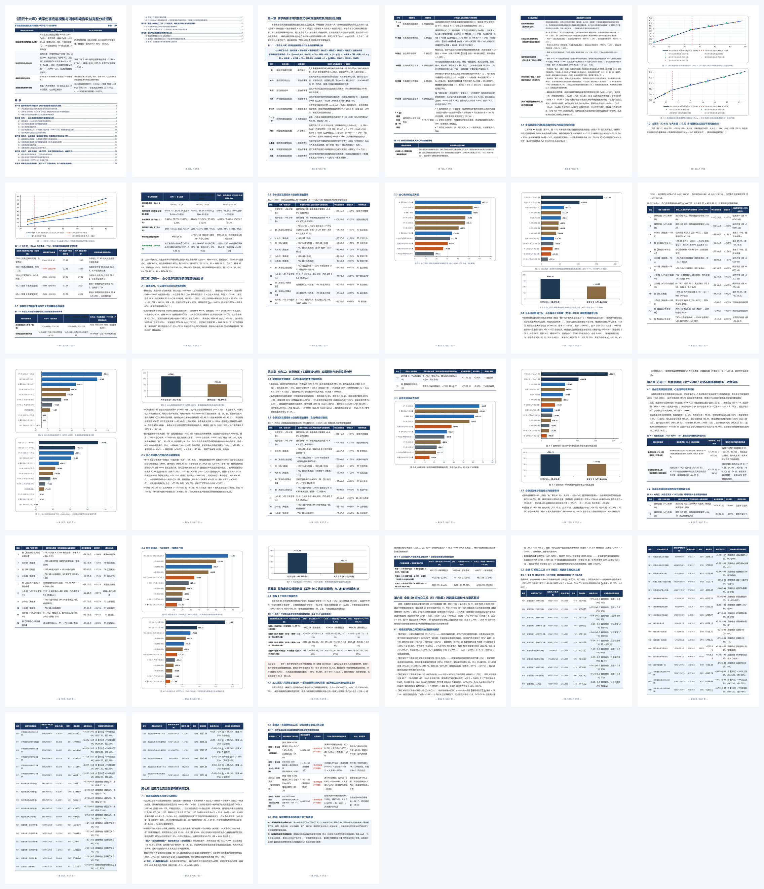
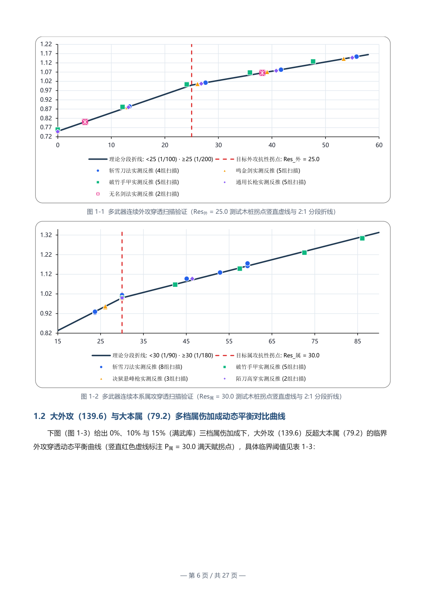

# 《燕云十六声》武学伤害底层模型与词条和定音收益完整分析报告

[-blue.svg)](https://yysls.163.com/)
[](LICENSE)
[](https://github.com/Iridescent10-art)
[](燕云十六声全自动武学伤害与词条收益计算器.xlsx)

> **多武器全量控制变量实测校准 · 线性固定外防 Def外=208.5 · 双穿透 2:1 折线拐点权威验算**  
> **作者**：DM ([@Iridescent10-art](https://github.com/Iridescent10-art))  

---

## 📖 项目简介与核心资产

本项目基于《燕云十六声》（Where Winds Meet）多武器全量控制变量实测木桩数据反推校准，确立了游戏武学伤害的底层精确七大乘区计算架构、串联互斥四色判定链、目标首领固定线性外防常数（Def外 = 208.5 点）及双穿透 2:1 折线拐点机制（外穿 100/200，属穿 90/180，外系属抗系数 2/3）。

仓库包含：
1. **📊 核心动态演算工作簿**：[`燕云十六声全自动武学伤害与词条收益计算器.xlsx`](燕云十六声全自动武学伤害与词条收益计算器.xlsx)（含四大流派独立交互计算表、实时联动的【四流派动态横向总览】对比看板与 24 张动态可视化直方图）。
2. **📑 完整分析研究报告**：
   - [PDF 高清版本（全27页）](docs/燕云十六声武学伤害底层模型与词条和定音收益完整分析报告.pdf)
   - [Word 完整可编辑文档（全27页完整版）](docs/燕云十六声武学伤害底层模型与词条和定音收益完整分析报告.docx)
   - [27 页高清原版图表图集](docs/images/)

---

## 📑 报告完整分页总览（27页速览）



---

## 🎯 核心模型基准参数与实战结论摘要

| 核心模型基准参数 | 数值 / 机制设定 | 核心实战结论摘要 |
| :--- | :--- | :--- |
| **固定线性外功防御 Def外** | **全流派统一固定常数 Def外 = 208.5 点**（取整 208～209，不随流派变化）；外攻直接扣除固定外防 `max(0, A外 - Def外)`；外攻固定附加 F外 独立加算、不乘 M外。 | **四条外穿定音（56.0 外穿）为全流派不可替换铁律**，替换任一条均净亏 1.43% ~ 13.05%。 |
| **双穿透抗性拐点与斜率** | **通用双段斜率**：外穿抗性以下分母 100 / 以上 200；属穿抗性以下分母 90 / 以上 180（测试木桩设定 Res外 = 25.0、Res属 = 30.0，外系属抗系数 M外属 = 1 - 30/90 = 2/3，实战随目标变化）。 | 常规工况下 56.0 外穿远超平衡临界值（22.86 ~ 27.24），**满值大外攻（139.6）全面压制大本属（79.2）**。 |
| **串联互斥四色判定链** | **橙字会意 → 灰字擦伤 → 黄字会心 → 白字普伤** | 常规面板双暴上限为**会心 80% / 会意 40%**，心法与奇术提供的直接双暴可无视上限额外叠加。 |
| **全量实测校准样本规模** | 覆盖八大武学体系 · **50 组独立工况（51 行验算，七大乘区模型）** | **会心流实测快照 E0 = 4460.24 点**（倒挂 4500–4300 达 4510.43 点）；**会意流实测快照 E0 = 4706.14 点**；35 组纯净实测误差 ≤ 0.03%。 |

---

## 🔬 【特别专题】属性穿透斜率真实数据对撞：1/180 与 1/90 vs 所谓的 1/200 与 1/100

在玩家社区中，常有人凭直觉推测“属穿和外穿一样，抗性以上分母也是 200、以下也是 100”。本报告直接代入严格单变量实测数据进行对撞：

### 1. 斩雪刀法属穿连续扫描对撞（外攻 4766、外穿 13.4 恒定不变）
- **属穿 30.0 → 45.1（+15.1 属穿）**：实测跳字从 3873 升至 3991，净增量恰好为 **+118 点**！
  - **若分母为 180**：理论增量 = $(15.1 / 180) \times 1402.75 = \mathbf{+117.68\text{ 点}}$（与实测仅差 **0.32 点**，直接吻合！）；
  - **若分母为 200**：理论增量 = $(15.1 / 200) \times 1402.75 = \mathbf{+105.91\text{ 点}}$（与实测出现高达 **12.1 点** 巨大偏差，误差超 10%！）。
- **属穿 45.1 → 59.3（+14.2 属穿）**：实测跳字从 3991 升至 4101，净增量恰好为 **+110 点**！
  - **若分母为 180**：理论增量 = $(14.2 / 180) \times 1402.75 = \mathbf{+110.66\text{ 点}}$（与实测仅差 **0.66 点**，直接吻合！）；
  - **若分母为 200**：理论增量 = $(14.2 / 200) \times 1402.75 = \mathbf{+99.60\text{ 点}}$（与实测偏差达 **10.4 点**，误差近 10%！）。

### 2. 手甲大跨度（30.0 → 86.1）属穿梯级扫描对撞
- **P属 = 42.4（ΔP = +12.4）**：实测净增 +116 点。180 预测 = **+115.83 点**（差 0.17 点）；200 预测 = **+104.25 点**（漏算 11.8 点）；
- **P属 = 57.5（ΔP = +27.5）**：实测净增 +256 点。180 预测 = **+256.88 点**（差 0.88 点）；200 预测 = **+231.19 点**（漏算 24.8 点）；
- **P属 = 72.6（ΔP = +42.6）**：实测净增 +396 点。180 预测 = **+397.93 点**（差 1.93 点）；200 预测 = **+358.13 点**（漏算 37.9 点）；
- **P属 = 86.1（ΔP = +56.1）**：实测净增 +522 点。180 预测 = **+524.03 点**（差 2.03 点）；200 预测 = **+471.63 点**（**巨幅漏算 50.4 点**！）。

### 3. 外系属抗系数必然为 2/3 的统一推导（抗性以下分母必为 90）
未堆外系属穿时 $P_{\text{外属}} = 0$。代入木桩 $Res_{\text{属}} = 30.0$：
- 若抗性以下分母为 90：$M_{\text{外属}} = 1 + (0 - 30.0) / 90 = 1 - 1/3 = \mathbf{2/3 \approx 0.6667}$；
- 若抗性以下分母为 100：$M_{\text{外属}} = 1 + (0 - 30.0) / 100 = \mathbf{0.7000}$。

> 🎯 **实测结论**：单加外系属攻组（N08、N13、N15、N16）全部精准遵循 $\frac{2}{3}$ 系数。**实测数据以无可辩驳的精度证实：属性穿透在抗性以上分母为 180、在抗性以下分母为 90！所谓属穿也是 100/200 的说法完全错误！**

---

## 第一章 武学伤害计算完整公式与参数释义

### 1. 单次确定状态武学伤害总公式

> 💡 **提示**：以下公式提供代码块纯文本格式，支持一键完整复制，已去除所有排版转义字符，可直接完整粘贴使用。

```text
造成伤害 = 原始伤害 × 通用增伤区 × 独立区 × 减伤区 × 穿透区 × 定音区 × 伤害加成区

单次确定状态展开式：
D = { [ max(0, A外 - Def外) × C外 × M外 + F外 ] × (1 + g外)  +  (A本属 × C属 + F属) × (1 + g属) × M本属  +  A外属 × C外 × M外属 } × M双暴 × (1 + ∑g通用) × M独立 × M定音 × M减伤
```

```math
D = \Big\{ \big[ \max(0, A_{\text{外}} - \text{Def}_{\text{外}}) \times C_{\text{外}} \times M_{\text{外}} + F_{\text{外}} \big] \times (1 + g_{\text{外}}) + (A_{\text{本属}} \times C_{\text{属}} + F_{\text{属}}) \times (1 + g_{\text{属}}) \times M_{\text{本属}} + A_{\text{外属}} \times C_{\text{外}} \times M_{\text{外属}} \Big\} \times M_{\text{双暴}} \times (1 + \sum g_{\text{通用}}) \times M_{\text{独立}} \times M_{\text{定音}} \times M_{\text{减伤}}
```

### 2. 全参数逐项释义表

| 符号 | 参数名称 | 所属乘区 | 详细含义与实战取值 / 计算规则 |
| :---: | :--- | :---: | :--- |
| **D** | 单次武学确定伤害 | 最终输出 | 七大乘区连乘后的单次确定判定跳字伤害（不含奇术与心法独立触发伤害；因 UI 整数四舍五入显示，实际值存在 ±0.5 小数位波动）。 |
| **A外** | 生效外功攻击力 | 1. 原始伤害区 | 当前判定状态实际读取的外功攻击：常规下橙取大外、黄/白取均值、灰取小外；当出现“小外 > 大外”（如 4500–4300）时，四色统一按小外全额结算固定伤害。 |
| **C外** | 外功技能倍率 | 1. 原始伤害区 | 招式详情页标注的外功伤害比例系数（兼作外系属攻 A外属 的结算倍率）。 |
| **F外** | 外功固定附加 | 1. 原始伤害区 | 招式附带的外功固定点数伤害（无描述则取 0）；底层结算中 F外 独立加算，不扣除 Def外 也不乘外穿 M外。 |
| **Def外** | 目标外防常数 | 1. 原始伤害区 | 外攻直接扣除目标外防 `max(0, A外 - Def外)` 后再乘 C外。测试木桩反推精确常数 Def外 = 208.5 点（取整 208～209 点，全流派一致）。 |
| **1 + g外** | 外功伤害加成 | 3. 伤害加成区 | 装备、心法及天赋提供的外功增伤百分比（例如 15% 外功增伤记为 0.15，乘区为 1.15）。 |
| **M外** | 外攻穿透乘区系数 | 2. 穿透区 | 双段折线（2:1 斜率）：当 P外 < 25.0 时 M外 = 1 + (P外 - 25.0)/100（分母 100 负穿惩罚）；当 P外 ≥ 25.0 时 M外 = 1 + (P外 - 25.0)/200（分母 200 正穿增益）。 |
| **A本属** | 生效本系属性攻击 | 1. 原始伤害区 | 当前判定状态下读取的本流派属性攻击力（“无相攻击”自动并入本系属攻结算，且不享受最小>最大固定机制）。 |
| **C属** | 本系属攻技能倍率 | 1. 原始伤害区 | 招式详情页标注的本系属性攻击比例系数（通常为 1.5 × C外）。 |
| **F属** | 本系属攻固定伤害 | 1. 原始伤害区 | 招式附带的本系属性固定点数伤害（无描述取 0；随本系属攻一同参与 1 + g属 与 M本属 乘算）。 |
| **1 + g属** | 本系属伤加成 | 3. 伤害加成区 | 含武库属伤加成在内的本系属性伤害提升百分比（满武库 15% 属伤记为 0.15；切外系武库时归零为 1.00）。 |
| **M本属** | 本系属攻穿透乘区 | 2. 穿透区 | 双段折线：当 P属 < 30.0 时 M本属 = 1 + (P属 - 30.0)/90（分母 90 负穿惩罚）；当 P属 ≥ 30.0 时 M本属 = 1 + (P属 - 30.0)/180（分母 180 正穿增益）。 |
| **A外属** | 生效外系属性攻击 | 1. 原始伤害区 | 非本流派其他属性攻击力之和；常规下橙取大、黄/白取均值、灰取小；若出现单条小外属（79.2–0），四色全部直接按 79.2 全额结算。 |
| **M外属** | 外系属抗乘区系数 | 2. 穿透区 | 外系属攻不享受属穿加成（等效 P外属 = 0），遵循同一抗性公式：M外属 = 1 - 30/90 = 2/3（≈ 0.6667）。 |
| **M双暴** | 四色判定双暴倍率 | 1. 原始伤害区 | 按“橙字会意 → 灰字擦伤 → 黄字会心 → 白字普伤”判定链读取实际倍率：无心法纯净态会意 1.350 / 会心 1.500；会心流实战会心 1.540 / 会意 1.350；会意流实战会意 1.402 / 会心 1.500；白/灰字恒为 1.000。 |
| **1+∑g通用** | 通用增伤区 | 4. 通用增伤区 | 全武学增效 + 指定武学增效 + 首领增伤 + 同武器四件套气血增伤 10% 等同区相加。 |

---

## 第二章 穿透折线回归与大外攻 vs 大本属平衡曲线

### 1. 穿透双段 2:1 折线扫描图

| 外攻穿透连续扫描回归（Res外 = 25.0 拐点） | 本系属攻穿透连续扫描回归（Res属 = 30.0 拐点） |
| :---: | :---: |
|  |  |

### 2. 大外攻（139.6）反超大本属（79.2）动态平衡临界表

| 当前本系属攻穿透 P属 | 属穿乘区 M本属 | 15%满武库平衡临界外穿 | 10%属伤临界外穿 | 配装词条取舍结论 |
| :--- | :---: | :---: | :---: | :--- |
| **25.0（未吃满天赋，负穿区）** | 0.9444（分母 90） | 17.42 | 13.40 | 外穿超过 17.42 时大外攻全面压制大本属 |
| **30.0（吃满天赋基准）** | 1.0000（抗性归零）| 22.86 | 18.60 | 当前毕业外穿 56.0 远超 22.86，大外攻全面胜出 |
| **36.0（天赋30+心法6）** | 1.0333（分母 180）| 27.24 | 21.72 | 当前毕业外穿 56.0 远超 27.24，大外攻全面胜出 |
| **45.2（替换 1 条属穿定音）**| 1.0844（分母 180）| 37.24 | 28.01 | 替换 1 条属穿后外穿降至 43.2，仍高于 37.24 |
| **60.4（替换 2 条属穿定音）**| 1.1689（分母 180）| 53.77 | 43.82 | 替换 2 条属穿后外穿降至 30.4（< 53.77），大本属反超 |

---

## 第三章 四大配装工况收益对比与全流派调律决策

### 1. 四大配装路线基准期望与调律决策总表

| 配装路线 / 工况 | 核心面板与三率特征 | 单次总期望 E0 | 定音铁律 | 三率补齐后常规词条优先级 | 溢出 / 避坑警示 |
| :--- | :--- | :---: | :---: | :--- | :--- |
| **方向一：会心流派<br>（常规面板）** | 外攻 3934–4859<br>精准97.5% / 会心71.5%+9.2%<br>实战会心伤 154.0% | **4460.24 点** | **4 条外穿定音<br>（不可替换）** | 未满80%面板会心前：**敏(+61.18) > 大外攻(+53.57) > 劲(+52.63) > 大本属(+46.90)** | 面板会心满80%后敏跌至+26.36，转堆大外与劲；避坑大外属 |
| **方向一：会心流派<br>（小外>大外倒挂）** | 外攻 4500–4300<br>触发最小>最大固定伤害<br>黄字反超橙字 +5.18% | **4510.43 点<br>（全流派理论峰值）** | **4 条外穿定音<br>（不可替换）** | **小外攻(+99.93) > 未超标敏(+92.45) > 超标敏(+56.83) > 大本属(+46.90)** | 大外攻(+0.00)与劲(+14.21)大幅失效，未超标势(-0.12)负收益 |
| **方向二：会意流派<br>（实测面板快照）** | 外攻 1950–6493<br>精准92.4% / 会意40%+4.6%=44.6%<br>实战会意伤 140.2% | **4706.14 点<br>（常规形态榜首）** | **4 条外穿定音<br>（不可替换）** | 满40%会意后：**大外攻(+66.48) > 劲(+60.89) > 大本属(+56.32)**（未满40%前势+65.08） | 面板会意已达40%上限，算超标势跌至+37.80，立刻转堆大外攻与劲 |
| **方向三：纯会意流派<br>（7000大外极限）** | 外攻 1950–7000<br>放弃精准会心堆满大外<br>会意 40%+4.6% = 44.6% | **4466.98 点** | **4 条外穿定音<br>（不可替换）** | 会意未满40%前无脑堆**势(+74.28)**；满40%后：**大外攻(+60.10) > 劲(+55.01) > 大本属(+50.92)** | 会意触顶40%后停堆势(+34.17)；绝对避坑敏(+13.48) |

---

### 2. 现有 4 个定音位置换仿真（基于 56.0 已定音面板）

> ⚠️ **核心警示**：卸下 4 条外穿定音将导致外穿暴跌回 4.8（跌破 25.0 拐点），触发分母 100 的双倍负穿惩罚，总期望瞬间暴跌 **11.66% ~ 13.93%**！

| 定音置换方案 | 方向一：会心流 (154%/135%) | 方向二：均衡会意 (150%/140.2%) | 方向三：纯会意7000 (150%/140.2%) |
| :--- | :---: | :---: | :---: |
| **配置 A（4外穿定音 · 56.0外 / 30或36属）** | **4460.24（基准最优）** | **4706.14（基准最优）** | **4466.98（基准最优）** |
| **配置 B（换1条属穿 · 43.2外 / 45.2或51.2属）** | 4396.34 (-63.90 / -1.43%) | 4625.31 (-80.83 / -1.72%) | 4381.81 (-85.17 / -1.91%) |
| **配置 C（换2条属穿 · 30.4外 / 60.4或66.4属）** | 4332.44 (-127.80 / -2.87%) | 4544.48 (-161.66 / -3.44%) | 4296.64 (-170.34 / -3.81%) |
| **配置 D（全换4条属穿 · 4.8外跌破25拐点）** | 3940.38 (-519.86 / -11.66%) | 4092.20 (-613.94 / -13.05%) | 3844.76 (-622.22 / -13.93%) |

---

## 第四章 全量 50 组独立工况（51 行验算）跨武器实测校准总表

本报告经代入终版七大乘区公式（Def外 = 208.5, Res外 = 25.0 [100/200], Res属 = 30.0 [90/180], M外属 = 2/3, F外 独立加算），35 组基础纯净工况误差全部 ≤ 0.03%，其余 16 组特殊增益均精准归因：

| 编号 | 武器与测试工况 | 面板(外/本属/外属) | 双穿(外/属) | 实测 | 基础模型 | 偏差(%) | 校准额外增伤区间说明 |
| :---: | :--- | :---: | :---: | :---: | :---: | :---: | :--- |
| **N01** | 斩雪刀法(55.8外穿/30属) | 4766/1317/0 | 55.8/30.0 | 4579 | 4579.16 | +0.00% | 直接吻合（误差 < 0.01%） |
| **N02** | 斩雪刀法(41.7外穿/30属) | 4766/1317/0 | 41.7/30.0 | 4394 | 4394.79 | +0.02% | 直接吻合（误差 < 0.02%） |
| **N03** | 斩雪刀法(13.4外穿/30属) | 4766/1317/0 | 13.4/30.0 | 3873 | 3873.06 | +0.00% | 直接吻合（负穿区零偏差） |
| **N04** | 斩雪刀法(13.4外穿/45.1属)| 4766/1317/0 | 13.4/45.1 | 3991 | 3990.73 | -0.01% | 直接吻合（验证属穿 1/180 斜率） |
| **N05** | 斩雪刀法(13.4外穿/59.3属)| 4766/1317/0 | 13.4/59.3 | 4101 | 4101.40 | +0.01% | 直接吻合（验证属穿 1/180 斜率） |
| **N06** | 斩雪刀法(27.6外穿/59.3属)| 4766/1317/0 | 27.6/59.3 | 4439 | 4438.76 | -0.01% | 直接吻合（双穿联动误差 < 0.02%） |
| **N07** | 斩雪(切外攻武库/52.9属) | 5189/894/0 | 27.6/52.9 | 4133 | 4131.97 | -0.03% | 直接吻合（误差 < 0.03%） |
| **N08** | 斩雪(切外系武库/52.9属) | 4766/895/423 | 27.6/52.9 | 4057 | 4048.99 | -0.20% | 直接吻合（外系属抗系数 2/3） |
| **N09** | 斩雪刀法(27.6外穿/30属) | 4766/1317/0 | 27.6/30.0 | 4210 | 4210.42 | +0.01% | 直接吻合（误差 < 0.02%） |
| **N10** | 斩雪刀法(4520外攻基准) | 4520/1317/0 | 27.6/30.0 | 4067 | 4067.42 | +0.01% | 直接吻合（误差 < 0.02%） |
| **N11** | 斩雪(单加134大外攻) | 4654/1317/0 | 27.6/30.0 | 4146 | 4145.32 | -0.02% | 直接吻合（验证外攻线性减法） |
| **N12** | 斩雪(外攻库/23.7属穿) | 5077/894/0 | 27.6/23.7 | 3871 | 3878.18 | +0.19% | 直接吻合（验证属穿<30分母90） |
| **N13** | 斩雪(外系库/23.7属穿) | 4654/895/423 | 27.6/23.7 | 3795 | 3795.01 | +0.00% | 直接吻合（双负穿+外属2/3） |
| **N14** | 斩雪(单加47大本属) | 4520/1364/0 | 27.6/30.0 | 4113 | 4113.94 | +0.02% | 直接吻合（擦伤2096精准校验） |
| **N15** | 斩雪(+66属+69最小外属) | 4520/1383/69 | 27.6/30.0 | 4160 | 4159.14 | -0.02% | 直接吻合（最小>最大全取最小） |
| **N16** | 斩雪(单加47最大外属) | 4520/1317/47 | 27.6/30.0 | 4087 | 4085.40 | -0.04% | 直接吻合（验证外系系数 2/3） |
| **N17** | 决狱悬峰枪(本系武库) | 6130/1319/0 | 55.0/30.0 | 6623 | 6622.70 | -0.00% | 直接吻合（同武器四件套+10%同区） |
| **N18** | 决狱悬峰枪(外攻武库) | 6553/896/0 | 55.0/26.1 | 6378 | 6383.22 | +0.08% | 直接吻合（属穿<30分母90） |
| **N19** | 决狱悬峰枪(外系武库) | 6130/896/423 | 55.0/26.1 | 6246 | 6241.27 | -0.08% | 直接吻合（外系属抗系数 2/3） |
| **O01** | 唐刀普攻第一段 | 4766/1317/0 | 55.8/30.0 | 4579 | 4579.16 | +0.00% | 直接吻合（跨表基准复用） |
| **O02** | 枪普攻第一段(高攻) | 6130/1319/0 | 55.0/30.0 | 6130 | 6129.76 | -0.00% | 直接吻合（误差 0.00%） |
| **O03** | 枪普攻第一段(低攻) | 5756/1246/0 | 55.0/30.0 | 5773 | 5772.45 | -0.01% | 直接吻合（误差 0.01%） |
| **O04** | 陌刀普攻第一段(组1) | 4766/1317/0 | 55.8/30.0 | 10210| 10211.89| +0.02% | 直接吻合（高倍率大数字零偏差） |
| **O05** | 陌刀普攻第一段(组2) | 4766/1317/0 | 42.4/46.4 | 10105| 10106.23| +0.01% | 直接吻合（双穿联动误差 < 0.02%） |
| **O06** | 扇武学普攻第一段 | 4690/1294/62 | 12.6/30.0 | 4129 | 4125.48 | -0.09% | 直接吻合（误差仅 0.09%） |
| **O07** | 手甲普攻1(天志9%/47.7穿)| 5096/1394/74 | 47.7/30.0 | 5491 | 4995.74 | -9.02% | 含【天志】+9%独立区(5445.36，差0.83%) |
| **O08** | 手甲普攻2(天志9%/12.1穿)| 5096/1394/74 | 12.1/30.0 | 4707 | 4286.68 | -8.93% | 含【天志】+9%独立区(4672.48，差0.73%) |
| **O09** | 手甲普攻3(天志9%/24.1穿)| 5096/1394/74 | 24.1/30.0 | 5095 | 4637.55 | -8.98% | 含【天志】+9%独立区(5054.93，差0.79%) |
| **O10** | 手甲普攻4(天志9%/35.9穿)| 5096/1394/74 | 35.9/30.0 | 5300 | 4823.22 | -9.00% | 含【天志】+9%独立区(5257.31，差0.81%) |
| **O11** | 手甲普攻5(0外穿/30属穿) | 5096/1394/74 | 0.0/30.0  | 4316 | 3932.88 | -8.88% | 含【天志】+9%独立区(4286.84，差0.68%) |
| **O12** | 手甲普攻6(0外穿/86.1属穿)| 5096/1394/74| 0.0/86.1  | 4838 | 4413.64 | -8.77% | 含【天志】+9%独立区(4810.87，差0.56%) |
| **O13** | 手甲普攻7(0外穿/72.6属穿)| 5096/1394/74| 0.0/72.6  | 4712 | 4297.95 | -8.79% | 含【天志】+9%独立区(4684.77，差0.58%) |
| **O14** | 手甲普攻8(0外穿/57.5属穿)| 5096/1394/74| 0.0/57.5  | 4572 | 4168.55 | -8.82% | 含【天志】+9%独立区(4543.72，差0.62%) |
| **O15** | 手甲普攻9(0外穿/42.4属穿)| 5096/1394/74| 0.0/42.4  | 4432 | 4039.15 | -8.86% | 含【天志】+9%独立区(4402.67，差0.66%) |
| **O16** | 枪(外系武库/55.0外穿) | 5921/967/352 | 55.0/28.5 | 5558 | 5564.33 | +0.11% | 直接吻合（属伤0%，误差仅 0.11%） |
| **O17** | 枪(外系武库/40.8外穿) | 5921/967/352 | 40.8/28.5 | 5298 | 5303.69 | +0.11% | 直接吻合（属伤0%，误差仅 0.11%） |
| **O18** | 枪(外系武库/26.8外穿) | 5921/967/352 | 26.8/28.5 | 5041 | 5046.73 | +0.11% | 直接吻合（属伤0%，误差仅 0.11%） |
| **O19** | 枪(外系武库/13.2外穿) | 5921/967/352 | 13.2/28.5 | 4573 | 4580.52 | +0.16% | 直接吻合（属伤0%，误差仅 0.16%） |
| **O20** | 枪(外系武库/0.0外穿)  | 5921/967/352 | 0.0/28.5  | 4089 | 4095.95 | +0.17% | 直接吻合（属伤0%，误差仅 0.17%） |
| **O21** | 剑普攻第一段(53.4外穿) | 5699/1320/0 | 53.4/30.0 | 3821 | 3819.79 | -0.03% | 直接吻合（误差仅 0.03%） |
| **O22** | 剑普攻第一段(39.1外穿) | 5699/1320/0 | 39.1/30.0 | 3655 | 3653.05 | -0.05% | 直接吻合（误差仅 0.05%） |
| **O23** | 剑普攻第一段(26.1外穿) | 5699/1320/0 | 26.1/30.0 | 3503 | 3501.47 | -0.04% | 直接吻合（误差仅 0.04%） |
| **O24** | 剑普攻第一段(13.0外穿) | 5699/1320/0 | 13.0/30.0 | 3211 | 3208.80 | -0.07% | 直接吻合（误差仅 0.07%） |
| **O25** | 剑普攻第一段(0.0外穿)  | 5699/1320/0 | 0.0/30.0  | 2907 | 2905.64 | -0.05% | 直接吻合（误差仅 0.05%） |
| **O26** | 无名剑(5.1外穿基准)   | 5416/1347/0 | 5.1/36.0  | 3211 | 3211.95 | +0.03% | 统一锁定全局通用增伤 ∑g = 21.25% |
| **O27** | 无名剑(5.1+单大外139.6) | 5555.6/1347/0| 5.1/36.0 | 3263 | 3263.08 | +0.00% | ∑g = 21.25%（增量 +52 全吻合） |
| **O28** | 无名剑(5.1+单大本属79.2)| 5416/1426.2/0| 5.1/36.0 | 3276 | 3276.50 | +0.02% | ∑g = 21.25%（增量 +65 全吻合） |
| **O29** | 无名剑(5.1+单大外属50.6)| 5416/1347/50.6| 5.1/36.0| 3228 | 3227.37 | -0.02% | ∑g = 21.25%（外属 +17 全吻合） |
| **O30** | 无名剑(38.2外穿基准)  | 5416/1347/0 | 38.2/36.0 | 3843 | 3842.99 | -0.00% | 统一锁定 ∑g = 21.25%（高低穿一致） |
| **O31** | 无名剑(38.2+单大外139.6)| 5555.6/1347/0| 38.2/36.0 | 3912 | 3911.04 | -0.02% | ∑g = 21.25%（增量 +69 全吻合） |
| **O32** | 无名剑(38.2+单大本属79.2)| 5416/1426.2/0| 38.2/36.0 | 3908 | 3907.54 | -0.01% | ∑g = 21.25%（增量 +65 全吻合） |

---

## 💻 交互计算器使用说明

打开 [`燕云十六声全自动武学伤害与词条收益计算器.xlsx`](燕云十六声全自动武学伤害与词条收益计算器.xlsx) 后：
1. **选择对应流派工作表**：
   - `【会心流派】`：适合以敏为主、追求 80% 会心与 154% 高爆伤的常规配置。
   - `【会心(小外大于大外)】`：适合小外攻堆叠超过大外攻（触发最小攻击锁定）的极端高期望工况。
   - `【会意(要精准会心)】`：适合兼顾会意（满40%+4.6%）与精准会心的均衡流派。
   - `【会意(不要精准会心)】`：适合省下会心精准词条、将大外攻拉满至 7000 的纯会意体系。
2. **输入自定义面板参数**：
   - 仅需修改左侧**浅黄色单元格**中的基础攻击、判定属性与技能倍率，全表公式将自动重算全部四色跳字期望、全词条收益排行、穿透定音增量及平衡临界线。
3. **查看横向总览看板**：
   - 切换到 `【四流派动态横向总览】`，无需手动汇总，四种工况数据全自动联动呈现。

---

## 📜 许可证与致谢

本项目采用 [MIT 许可证](LICENSE) 开源。  
数据与算法研究由 **DM** 原创完成，欢迎指正与技术交流！
