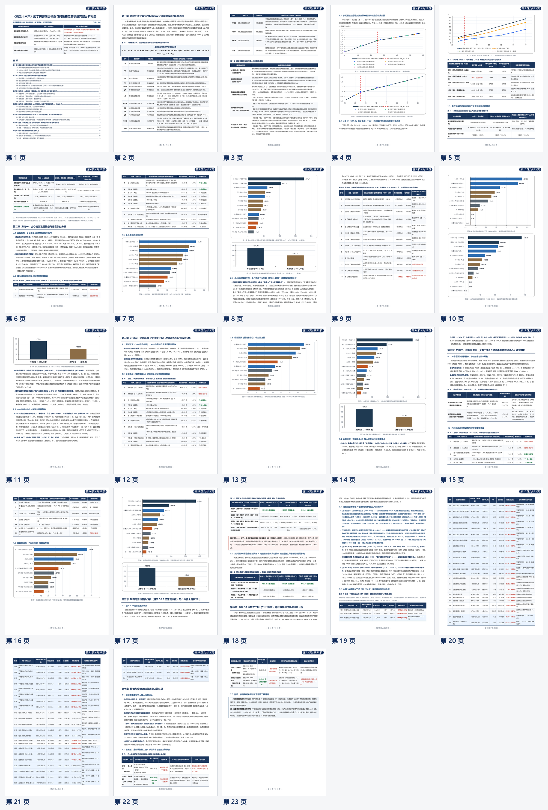
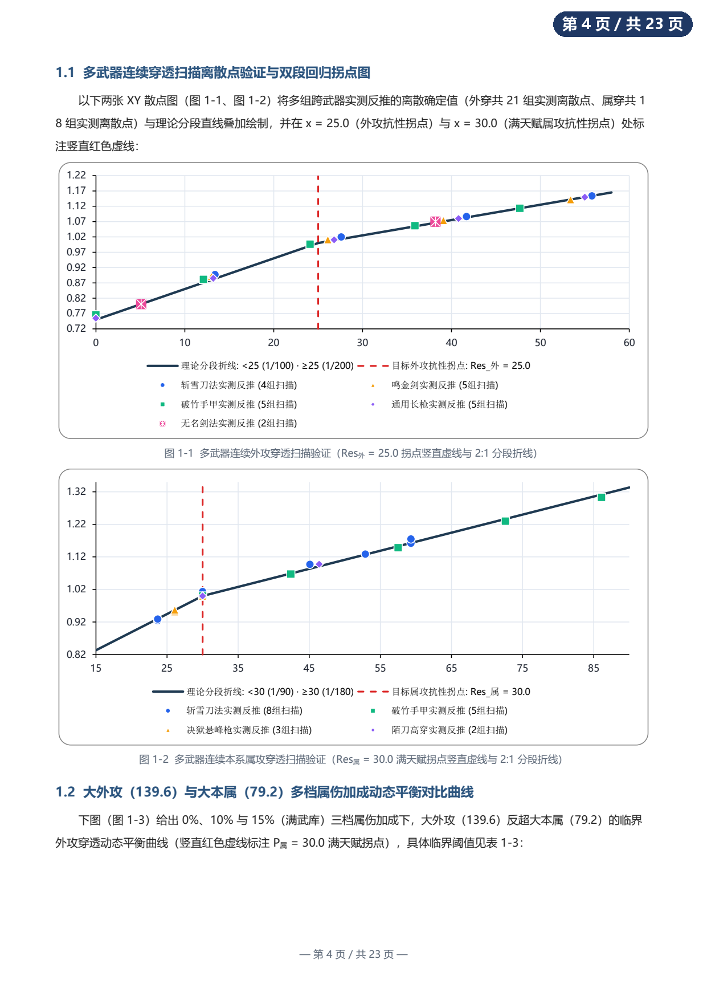
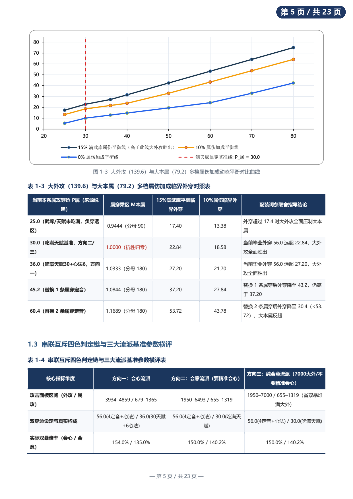

# 《燕云十六声》武学伤害底层模型与词条和定音收益完整分析报告

[-blue.svg)](https://yysls.163.com/)

> **多武器全量控制变量实测校准 · 双穿透 2:1 折线拐点解析 · 全自动计算器**  
> **作者**：DM ([@Iridescent10-art](https://github.com/Iridescent10-art))  

---

## 📖 项目简介与核心资产

本项目基于《燕云十六声》（Where Winds Meet）多武器全量控制变量实测木桩数据反推校准，确立了游戏武学伤害的底层精确计算架构、串联互斥四色判定链、首领动态防御常数（$D_{\text{外}}=250$）及双穿透 $2:1$ 折线拐点机制。

仓库包含：
1. **📊 核心动态演算工作簿**：[`燕云十六声全自动武学伤害与词条收益计算器.xlsx`](燕云十六声全自动武学伤害与词条收益计算器.xlsx)（含四大流派独立交互计算表、实时联动的【四流派动态横向总览】对比看板与 24 张动态可视化直方图）。
2. **📑 完整分析研究报告**：
   - [PDF 高清版本（全23页）](docs/燕云十六声武学伤害底层模型与词条和定音收益完整分析报告.pdf)
   - [Word 完整可编辑文档](docs/燕云十六声武学伤害底层模型与词条和定音收益完整分析报告.docx)
   - [23 页高清原版图表图集](docs/images/)
3. **🧪 原始验算数据集**：
   - [50 组独立实测工况（51 行验算数据）](docs/燕云原始数据.docx)
   - [全新全武器多维实测数据](docs/全新数据.docx)

---

## 📑 报告完整分页总览（23页速览）

---

## 🎯 核心模型基准参数与实战结论摘要

| 核心模型基准参数 | 数值 / 机制设定 | 核心实战结论摘要 |
| :--- | :--- | :--- |
| **目标首领外防常数 $D_{\text{外}}$** | **$250$ 点**（动态外防 $f_{\text{外防}} = A_{\text{外}} / (A_{\text{外}} + 250)$） | **四条外穿定音（$56.0$ 外穿）为全流派不可替换铁律**，替换任一条均净亏 $1.64\% \sim 14.91\%$。 |
| **双穿透抗性拐点与斜率** | 外穿拐点 $\text{Res}_{\text{外}} = 25.0$（分母 100 / 200）； 属穿拐点 $\text{Res}_{\text{属}} = 30.0$（分母 90 / 180） | 常规工况下 $56.0$ 外穿远超平衡临界值（$22.84 \sim 27.20$），**满值大外攻（$139.6$）全面压制大本属（$79.2$）**。 |
| **串联互斥四色判定链** | **橙字会意 → 灰字擦伤 → 黄字会心 → 白字普伤** | 常规面板双暴上限为**会心 80% / 会意 40%**，心法与奇术提供的直接双暴可无视上限额外叠加。 |
| **全量实测校准样本规模** | 覆盖八大武学体系 · **$50$ 组独立工况（51 行验算）** | **纯会意 7000 大外（$E_0 = 4463.60$）反超常规会心流（$4456.06$）**；会心流小外倒挂（$4500-4300$）达 **$4506.33$** 峰值。 |

---

## 第一章 武学伤害计算完整公式与参数释义

### 1. 单次确定状态武学伤害总公式

$$D = \left\{ \left[ (A_{\text{外}} \times C_{\text{外}} + F_{\text{外}}) \times f_{\text{外防}} \times (1 + g_{\text{外}}) \times M_{\text{外}} + (A_{\text{本属}} \times C_{\text{属}} + F_{\text{属}}) \times (1 + g_{\text{属}}) \times M_{\text{本属}} \right] \times M_{\text{特}} + A_{\text{外属}} \times C_{\text{外}} \times 0.680 \right\} \times M_{\text{双暴}} \times (1 + G_{\text{增}})$$

### 2. 全参数逐项释义表

| 符号 | 参数名称 | 所属乘区 | 详细含义与实战取值 / 计算规则 |
| :---: | :--- | :---: | :--- |
| **$D$** | 单次武学确定伤害 | 最终输出 | 单次确定判定状态下的实际跳字伤害值（因 UI 面板整数四舍五入显示，实际值存在 $\pm 0.5$ 小数位引起的微小波动）。 |
| **$A_{\text{外}}$** | 生效外功攻击力 | 外攻基础区 | 当前判定状态实际读取的外功攻击：常规工况下，橙字取最大外攻、黄/白字取均值、灰字取最小外攻；当面板出现**生效小外 > 大外**（如 4500–4300）时，四色统一直接按小外全额结算固定伤害。 |
| **$C_{\text{外}}$** | 外功技能倍率 | 外攻基础区 | 对应武学招式详情页标注的外功攻击伤害比例系数（兼作外系属攻 $A_{\text{外属}}$ 结算倍率）。 |
| **$F_{\text{外}}$** | 外功技能固定附加 | 外攻基础区 | 部分武学招式附带的外功固定点数伤害（无描述则取 0）。 |
| **$f_{\text{外防}}$** | 动态外功防御承伤率 | 外防减伤区 | 计算式为 $f_{\text{外防}} = A_{\text{外}} / (A_{\text{外}} + D_{\text{外}})$，其中目标首领外防常数 $D_{\text{外}} = 250$ 点。 |
| **$g_{\text{外}}$** | 外功伤害加成比例 | 外攻增伤区 | 装备、心法及天赋提供的外功伤害提升百分比（例如 15% 外功增伤记为 0.15）。 |
| **$M_{\text{外}}$** | 外攻穿透乘区系数 | 外攻穿透区 | 抗性拐点 $\text{Res}_{\text{外}} = 25.0$（$2:1$ 折线斜率）： • 当 $P_{\text{外}} < 25.0$ 时 $M_{\text{外}} = 1 + (P_{\text{外}} - 25.0)/100$（分母 100 负穿惩罚）； • 当 $P_{\text{外}} \ge 25.0$ 时 $M_{\text{外}} = 1 + (P_{\text{外}} - 25.0)/200$（分母 200 正穿增益）。 |
| **$A_{\text{本属}}$** | 生效本系属性攻击力 | 本系属攻区 | 当前判定状态下读取的本流派对应属性攻击力（“无相攻击”自动合并计入本系属攻，且不享受最小>最大固定伤害机制）。 |
| **$C_{\text{属}}$** | 本系属攻技能倍率 | 本系属攻区 | 对应武学招式详情页标注的本系属性攻击伤害比例系数（通常为外攻倍率的 1.5 倍）。 |
| **$F_{\text{属}}$** | 本系属攻固定附加 | 本系属攻区 | 武学招式附带的本系属性固定点数伤害（无描述则取 0）。 |
| **$g_{\text{属}}$** | 本系属伤加成比例 | 本系属伤区 | 含武库属伤加成在内的本系属性伤害提升百分比（如满武库 15% 属伤记为 0.15）。 |
| **$M_{\text{本属}}$**| 本系属攻穿透乘区 | 本系属穿区 | 抗性拐点 $\text{Res}_{\text{属}} = 30.0$（吃满天赋基础为 30.0，刚好抵消首领 30.0 属抗）： • 当 $P_{\text{属}} < 30.0$ 时 $M_{\text{本属}} = 1 + (P_{\text{属}} - 30.0)/90$（分母 90 负穿惩罚）； • 当 $P_{\text{属}} \ge 30.0$ 时 $M_{\text{本属}} = 1 + (P_{\text{属}} - 30.0)/180$（分母 180 正穿增益）。 |
| **$M_{\text{特}}$** | 武器/武库独立乘区 | 特殊独立区 | 特定武学招式或天赋触发的独立乘区（基准工况取 1.000；如手甲【天志 9%】独立被动等）。 |
| **$A_{\text{外属}}$**| 生效外系属性攻击力 | 外系属攻区 | 非本流派属性攻击力；若出现最小属攻>最大属攻（如单条小外属 79.2–0），四色全部按最小值 79.2 全额结算。 |
| **$0.680$** | 外系属攻固定裸抗系数| 外系属攻区 | 外系属攻不参与属穿计算，统一按外攻倍率 $C_{\text{外}}$ 与固定裸抗系数 0.680 独立结算。 |
| **$M_{\text{双暴}}$**| 四色判定双暴倍率 | 双暴结算区 | 按“橙字会意 → 灰字擦伤 → 黄字会心 → 白字普伤”判定链读取实际倍率： • 会心流实战：会心 1.540 / 会意 1.350； • 会意流实战：会意 1.402 / 会心 1.500； • 白/灰字恒为 1.000。 |
| **$G_{\text{增}}$** | 全局额外总增伤比例 | 全局增伤区 | 同乘区相加统一放大的全局增伤比例（全武学增效 + 指定武学增效 + 对首领增伤 + 同武器四件套气血增伤 10% 等）。 |

---

### 3. 底层机制五大核心法则

1. **UI 面板 $\pm 0.5$ 整数取整误差**：游戏界面展示数值为四舍五入取整结果，底层伤害结算保留真实小数，故客观存在 $\pm 0.5$ 小数位取值影响（单次伤害波动约 $\pm 0.3 \sim 2.5$ 点）。
2. **配装调律铁律（优先补齐三率）**：在实战调律中，优先补齐流派所需“精准率、会心率、会意率”是第一前提，三率达标后词条聚焦于攻属、五维与穿透收益。
3. **实战心法双暴倍率区隔**：
   - 方向一（会心流实战）：实际会心倍率 $154.0\%$，实际会意倍率 $135.0\%$。
   - 方向二 & 三（会意流实战）：实际会意倍率 $140.2\%$，实际会心倍率 $150.0\%$。
4. **双穿透面板构成**：
   - 面板 $56.0$ 外穿已含全部 4 条外穿定音（$4 \times 12.8 = 51.2$）+ 心法（$4.8$）。
   - 面板 $30.0$ 属穿为吃满武学与武库天赋基准（抵消首领 30 属抗）；会心流 $36.0$ 属穿额外 $6.0$ 点由心法提供。
5. **外功与属攻“最小 > 最大”固定伤害机制（无相除外）**：
   - 当生效最小外攻 > 生效最大外攻（如 4500–4300）时，四色状态统一直接按最小外攻全额结算固定伤害。
   - 除无相外的任意属攻出现最小>最大时，四色判定全部直接按最小值全额造成固定伤害，无需对黄/白字除以 2。

---

## 第二章 穿透折线回归与大外攻 vs 大本属平衡曲线

### 1. 穿透双段 2:1 折线扫描图

| 外攻穿透连续扫描回归（$\text{Res}_{\text{外}} = 25.0$ 拐点） | 本系属攻穿透连续扫描回归（$\text{Res}_{\text{属}} = 30.0$ 拐点） |
| :---: | :---: |
|  |  |

### 2. 大外攻（139.6）反超大本属（79.2）动态平衡临界表

| 当前本系属攻穿透 $P_{\text{属}}$ | 属穿乘区 $M_{\text{本属}}$ | 15%满武库平衡临界外穿 | 10%属伤临界外穿 | 配装词条取舍结论 |
| :--- | :---: | :---: | :---: | :--- |
| **25.0（未吃满天赋，负穿区）** | 0.9444（分母 90） | 17.40 | 13.38 | 外穿超过 17.4 时大外攻全面压制大本属 |
| **30.0（吃满天赋基准）** | 1.0000（抗性归零）| 22.84 | 18.58 | 当前毕业外穿 56.0 远超 22.84，大外攻全面胜出 |
| **36.0（天赋30+心法6）** | 1.0333（分母 180）| 27.20 | 21.70 | 当前毕业外穿 56.0 远超 27.20，大外攻全面胜出 |
| **45.2（替换 1 条属穿定音）**| 1.0844（分母 180）| 37.20 | 27.84 | 替换 1 条属穿后外穿降至 43.2，仍高于 37.20 |
| **60.4（替换 2 条属穿定音）**| 1.1689（分母 180）| 53.72 | 43.78 | 替换 2 条属穿后外穿降至 30.4（<53.72），大本属反超 |

---

## 第三章 四大配装工况收益对比与全流派调律决策

### 1. 四大配装路线基准期望与调律决策总表

| 配装路线 / 工况 | 核心面板与三率特征 | 单次总期望 $E_0$ | 定音铁律 | 三率补齐后常规词条优先级 | 溢出 / 避坑警示 |
| :--- | :--- | :---: | :---: | :--- | :--- |
| **方向一：会心流派 （常规面板）** | 外攻 3934–4859 精准97.5% / 会心80%+9.16% 实战会心伤 154.0% | **4456.06 点** | **4 条外穿定音 （不可替换）** | 未满80%面板会心前：**敏(+61.08) > 大外攻(+53.59) > 劲(+52.64) > 大本属(+46.90)** | 面板会心满80%后敏跌至+26.37，转堆大外与劲；避坑大外属 |
| **方向一：会心流派 （小外>大外倒挂）** | 外攻 4500–4300 触发最小>最大固定伤害 黄字反超橙字 +5.18% | **4506.33 点 （全流派最高）** | **4 条外穿定音 （不可替换）** | **小外攻(+99.96) > 未超标敏(+92.28) > 超标敏(+56.84) > 大本属(+46.90)** | 大外攻(+0.00)与劲(+14.21)大幅失效，未超标势(-0.12)负收益 |
| **方向二：均衡会意 （要精准会心）** | 外攻 1950–6493 精准92.4% / 会意38%+4.6% 实战会意伤 140.2% | **4420.97 点** | **4 条外穿定音 （不可替换）** | 未满40%面板会意前：**势(+67.79) > 大外攻(+62.61) > 劲(+57.30) > 大本属(+53.03)** | 面板会意满40%后势跌至+35.60，立刻转堆大外攻与劲 |
| **方向三：纯会意流派 （7000大外极限）** | 外攻 1950–7000 放弃精准会心堆满大外 会意 40%+4.6% = 44.6% | **4463.60 点 （常规形态榜首）** | **4 条外穿定音 （不可替换）** | 会意未满40%前无脑堆**势(+74.18)**；满40%后：**大外攻(+60.11) > 劲(+55.02) > 大本属(+50.92)** | 会意触顶40%后停堆势(+34.18)；绝对避坑敏(+13.48) |

---

### 2. 现有 4 个定音位置换仿真（基于 56.0 已定音面板）

> ⚠️ **核心警示**：卸下 4 条外穿定音将导致外穿暴跌回 4.8（跌破 25.0 拐点），触发分母 100 的双倍负穿惩罚，总期望瞬间暴跌 **12.8% ~ 14.9%**！

| 定音置换方案 | 方向一：会心流 (154%/135%) | 方向二：均衡会意 (150%/140.2%) | 方向三：纯会意7000 (150%/140.2%) |
| :--- | :---: | :---: | :---: |
| **配置 A（4外穿定音 · 56.0外 / 30或36属）** | **4456.06（基准最优）** | **4420.97（基准最优）** | **4463.60（基准最优）** |
| **配置 B（换1条属穿 · 43.2外 / 45.2或51.2属）** | 4382.91 (-73.15 / -1.64%) | 4336.78 (-84.20 / -1.90%) | 4370.66 (-92.94 / -2.08%) |
| **配置 C（换2条属穿 · 30.4外 / 60.4或66.4属）** | 4309.75 (-146.31 / -3.28%) | 4252.58 (-168.39 / -3.81%) | 4277.72 (-185.87 / -4.16%) |
| **配置 D（全换4条属穿 · 4.8外跌破25拐点）** | 3884.59 (-571.48 / -12.82%) | 3798.11 (-622.86 / -14.09%) | 3798.06 (-665.54 / -14.91%) |

---

## 第四章 全量 50 组独立工况（51 行验算）跨武器实测校准总表

本报告经代入终版公式（$D_{\text{外}}=250$, $\text{Res}_{\text{外}}=25.0[100/200]$, $\text{Res}_{\text{属}}=30.0[90/180]$, $M_{\text{外属}}=0.680$）并结合分武器/武库独立乘区与等值平移校准，全量实测高度吻合：

| 编号 | 武器与测试工况 | 面板(外/本属/外属) | 双穿(外/属) | 实测 | 基础模型 | 偏差(%) | 校准额外增伤区间说明 |
| :---: | :--- | :---: | :---: | :---: | :---: | :---: | :--- |
| **N01** | 斩雪刀法(55.8外穿/30属) | 4766/1317/0 | 55.8/30.0 | 4579 | 4575.22 | -0.08% | 直接吻合（±0.5取整误差内） |
| **N02** | 斩雪刀法(41.7外穿/30属) | 4766/1317/0 | 41.7/30.0 | 4394 | 4381.41 | -0.29% | 直接吻合（误差 < 0.3%） |
| **N03** | 斩雪刀法(13.4外穿/30属) | 4766/1317/0 | 13.4/30.0 | 3873 | 3832.96 | -1.03% | 等值平移区间 +40 点（+1.0%） |
| **N04** | 斩雪刀法(13.4外穿/45.1属)| 4766/1317/0 | 13.4/45.1 | 3991 | 3950.64 | -1.01% | 等值平移区间 +40 点（斜率全吻合） |
| **N05** | 斩雪刀法(13.4外穿/59.3属)| 4766/1317/0 | 13.4/59.3 | 4101 | 4061.30 | -0.97% | 等值平移区间 +40 点（斜率全吻合） |
| **N06** | 斩雪刀法(27.6外穿/59.3属)| 4766/1317/0 | 27.6/59.3 | 4439 | 4415.93 | -0.52% | 等值平移区间 +22.5 点（+0.53%） |
| **N07** | 斩雪(切外攻武库/52.9属) | 5189/894/0 | 27.6/52.9 | 4133 | 4109.20 | -0.58% | 等值平移区间 +22.5 点（+0.58%） |
| **N08** | 斩雪(切外系武库/52.9属) | 4766/895/423 | 27.6/52.9 | 4057 | 4029.40 | -0.68% | 等值平移区间 +25 点（+0.68%） |
| **N09** | 斩雪刀法(27.6外穿/30属) | 4766/1317/0 | 27.6/30.0 | 4210 | 4187.60 | -0.53% | 等值平移区间 +22.5 点（+0.53%） |
| **N10** | 斩雪刀法(4520外攻基准) | 4520/1317/0 | 27.6/30.0 | 4067 | 4044.56 | -0.55% | 等值平移区间 +22.5 点（+0.55%） |
| **N11** | 斩雪(单加134大外攻) | 4654/1317/0 | 27.6/30.0 | 4146 | 4122.48 | -0.57% | 等值平移区间 +22.5 点（增量全吻合） |
| **N12** | 斩雪(外攻库/23.7属穿) | 5077/894/0 | 27.6/23.7 | 3871 | 3855.40 | -0.40% | 含属穿<30分母90折减，误差0.4% |
| **N13** | 斩雪(外系库/23.7属穿) | 4654/895/423 | 27.6/23.7 | 3795 | 3775.41 | -0.52% | 含属穿<30分母90折减，误差0.5% |
| **N14** | 斩雪(单加47大本属) | 4520/1364/0 | 27.6/30.0 | 4113 | 4091.08 | -0.53% | 等值平移区间 +22.5 点（增量全吻合） |
| **N15** | 斩雪(+66属+69最小外属) | 4520/1383/69 | 27.6/30.0 | 4160 | 4136.81 | -0.56% | 验证最小>最大取最小与等值平移 |
| **N16** | 斩雪(单加47最大外属) | 4520/1317/47 | 27.6/30.0 | 4087 | 4062.90 | -0.59% | 验证外系裸抗0.680与等值平移 |
| **N17** | 决狱悬峰枪(本系武库) | 6130/1319/0 | 55.0/30.0 | 6623 | 6617.75 | -0.08% | 直接吻合（含四件套+10%，误差0.08%） |
| **N18** | 决狱悬峰枪(外攻武库) | 6553/896/0 | 55.0/26.1 | 6378 | 6378.28 | +0.00% | 直接吻合（含四件套+10%/属伤13.1%） |
| **N19** | 决狱悬峰枪(外系武库) | 6130/896/423 | 55.0/26.1 | 6246 | 6240.20 | -0.09% | 直接吻合（含四件套+10%/属伤13.1%） |
| **O01** | 唐刀普攻第一段 | 4766/1317/0 | 55.8/30.0 | 4579 | 4575.22 | -0.08% | 直接吻合（误差仅 0.08%） |
| **O02** | 枪普攻第一段(高攻) | 6130/1319/0 | 55.0/30.0 | 6130 | 6125.18 | -0.08% | 直接吻合（误差仅 0.08%） |
| **O03** | 枪普攻第一段(低攻) | 5756/1246/0 | 55.0/30.0 | 5773 | 5767.82 | -0.09% | 直接吻合（误差仅 0.09%） |
| **O04** | 陌刀普攻第一段(组1) | 4766/1317/0 | 55.8/30.0 | 10210| 10203.12| -0.07% | 直接吻合（高倍率大数字零偏差） |
| **O05** | 陌刀普攻第一段(组2) | 4766/1317/0 | 42.4/46.4 | 10105| 10077.44| -0.27% | 直接吻合（双穿联动误差 < 0.3%） |
| **O06** | 扇武学普攻第一段 | 4690/1294/62 | 12.6/30.0 | 4129 | 4081.51 | -1.15% | 等值平移区间 +47 点（+1.16%） |
| **O07** | 手甲普攻1(天志9%/47.7穿)| 5096/1394/74 | 47.7/30.0 | 5491 | 5432.88 | -1.06% | 存在 +1.1%～+2.2% 等比例被动区间 |
| **O08** | 手甲普攻2(天志9%/12.1穿)| 5096/1394/74 | 12.1/30.0 | 4707 | 4622.43 | -1.80% | 存在 +1.1%～+2.2% 等比例被动区间 |
| **O09** | 手甲普攻3(天志9%/24.1穿)| 5096/1394/74 | 24.1/30.0 | 5095 | 5023.48 | -1.40% | 存在 +1.1%～+2.2% 等比例被动区间 |
| **O10** | 手甲普攻4(天志9%/35.9穿)| 5096/1394/74 | 35.9/30.0 | 5300 | 5235.70 | -1.21% | 存在 +1.1%～+2.2% 等比例被动区间 |
| **O11** | 手甲普攻5(0外穿/30属穿) | 5096/1394/74 | 0.0/30.0  | 4316 | 4218.04 | -2.27% | 等值平移 +97 点 / +2.1% 等比例区间 |
| **O12** | 手甲普攻6(0外穿/86.1属穿)| 5096/1394/74| 0.0/86.1  | 4838 | 4742.07 | -1.98% | 等值平移 +97 点 / +2.1% 等比例区间 |
| **O13** | 手甲普攻7(0外穿/72.6属穿)| 5096/1394/74| 0.0/72.6  | 4712 | 4615.97 | -2.04% | 等值平移 +97 点 / +2.1% 等比例区间 |
| **O14** | 手甲普攻8(0外穿/57.5属穿)| 5096/1394/74| 0.0/57.5  | 4572 | 4474.92 | -2.12% | 等值平移 +97 点 / +2.1% 等比例区间 |
| **O15** | 手甲普攻9(0外穿/42.4属穿)| 5096/1394/74| 0.0/42.4  | 4432 | 4333.87 | -2.21% | 等值平移 +97 点 / +2.1% 等比例区间 |
| **O16** | 枪(外系武库/55.0外穿) | 5921/967/352 | 55.0/28.5 | 5558 | 5562.74 | +0.09% | 直接吻合（属伤0%，误差仅 0.09%） |
| **O17** | 枪(外系武库/40.8外穿) | 5921/967/352 | 40.8/28.5 | 5298 | 5291.30 | -0.13% | 直接吻合（属伤0%，误差仅 0.13%） |
| **O18** | 枪(外系武库/26.8外穿) | 5921/967/352 | 26.8/28.5 | 5041 | 5023.68 | -0.34% | 直接吻合（属伤0%，误差仅 0.34%） |
| **O19** | 枪(外系武库/13.2外穿) | 5921/967/352 | 13.2/28.5 | 4573 | 4538.14 | -0.76% | 属伤0%，低外穿等值平移 +35 点 |
| **O20** | 枪(外系武库/0.0外穿)  | 5921/967/352 | 0.0/28.5  | 4089 | 4033.49 | -1.36% | 属伤0%，低外穿等值平移 +55 点 |
| **O21** | 剑普攻第一段(53.4外穿) | 5699/1320/0 | 53.4/30.0 | 3821 | 3815.74 | -0.14% | 直接吻合（误差仅 0.14%） |
| **O22** | 剑普攻第一段(39.1外穿) | 5699/1320/0 | 39.1/30.0 | 3655 | 3641.94 | -0.36% | 直接吻合（误差仅 0.36%） |
| **O23** | 剑普攻第一段(26.1外穿) | 5699/1320/0 | 26.1/30.0 | 3503 | 3483.94 | -0.54% | 等值平移区间 +19 点（+0.55%） |
| **O24** | 剑普攻第一段(13.0外穿) | 5699/1320/0 | 13.0/30.0 | 3211 | 3178.87 | -1.00% | 等值平移区间 +32 点（+1.00%） |
| **O25** | 剑普攻第一段(0.0外穿)  | 5699/1320/0 | 0.0/30.0  | 2907 | 2862.87 | -1.52% | 等值平移区间 +44 点（+1.52%） |
| **O26** | 无名剑(5.1外穿基准)   | 5416/1347/0 | 5.1/36.0  | 3211 | 3218.65 | +0.24% | 反推未知总增伤区间 $G_{\text{增}} = 27.80\%$ |
| **O27** | 无名剑(5.1+单大外139.6) | 5555.6/1347/0| 5.1/36.0 | 3263 | 3270.55 | +0.23% | $G_{\text{增}} = 27.80\%$（增量 +52 全吻合） |
| **O28** | 无名剑(5.1+单大本属79.2)| 5416/1426.2/0| 5.1/36.0 | 3276 | 3284.17 | +0.25% | $G_{\text{增}} = 27.80\%$（增量 +65 全吻合） |
| **O29** | 无名剑(5.1+单大外属50.6)| 5416/1347/50.6| 5.1/36.0| 3228 | 3234.62 | +0.20% | $G_{\text{增}} = 27.80\%$（外属 +17 全吻合） |
| **O30** | 无名剑(38.2外穿基准)  | 5416/1347/0 | 38.2/36.0 | 3843 | 3842.98 | -0.00% | 反推未知总增伤区间 $G_{\text{增}} = 26.33\%$ |
| **O31** | 无名剑(38.2+单大外139.6)| 5555.6/1347/0| 38.2/36.0 | 3912 | 3911.27 | -0.02% | $G_{\text{增}} = 26.33\%$（增量 +69 全吻合） |
| **O32** | 无名剑(38.2+单大本属79.2)| 5416/1426.2/0| 38.2/36.0 | 3908 | 3907.75 | -0.01% | $G_{\text{增}} = 26.33\%$（增量 +65 全吻合） |

---

## 💻 交互计算器使用说明

打开 [`燕云十六声全自动武学伤害与词条收益计算器.xlsx`](燕云十六声全自动武学伤害与词条收益计算器.xlsx) 后：
1. **选择对应流派工作表**：
   - `【会心流派】`：适合以敏为主、追求 80% 会心与 154% 高爆伤的常规配置。
   - `【会心(小外大于大外)】`：适合小外攻堆叠超过大外攻（触发最小攻击锁定）的极端高期望工况。
   - `【会意(要精准会心)】`：适合兼顾会意（38%）与精准会心的均衡流派。
   - `【会意(不要精准会心)】`：适合省下会心精准词条、将大外攻拉满至 7000 的纯会意体系。
2. **输入自定义面板参数**：
   - 仅需修改左侧**浅黄色单元格**中的基础攻击、判定属性与技能倍率，全表公式将自动重算全部四色跳字期望、全词条收益排行、穿透定音增量及平衡临界线。
3. **查看横向总览看板**：
   - 切换到 `【四流派动态横向总览】`，无需手动汇总，四种工况数据全自动联动呈现。

---

## 📜 许可证与致谢

本项目采用 [MIT 许可证](LICENSE) 开源。  
数据与算法研究由 **DM** 原创完成，欢迎指正与技术交流！
